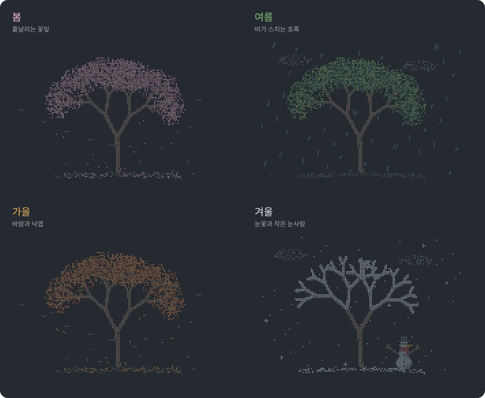

# 살랑 · Salang

**오늘의 날씨와 계절이 머무는 터미널 정원.**

벚꽃이 흩날리고, 비가 지나가고, 낙엽이 떨어지고, 가지에 눈이 쌓입니다.
터미널 한쪽에 살랑을 켜 두면 선택한 지역의 날씨에 따라 작은 풍경이 움직입니다.



## 설치

> 아직 첫 GitHub 릴리스 게시 전입니다. 아래 설치 명령은 저장소와 릴리스가 공개된 뒤 사용할 수 있습니다. Homebrew 설치는 아직 제공하지 않습니다.

macOS 또는 Linux의 터미널에 아래 한 줄을 붙여 넣으세요.

```sh
curl -fsSL https://raw.githubusercontent.com/100space/salang/main/install.sh | sh
```

설치가 끝나면 **새 터미널을 열고** 실행합니다.

```sh
salang
```

Python·Git 설치나 회원가입, API 키 없이 사용할 수 있습니다. 관리자 권한은 필요하지 않습니다.

업데이트할 때도 같은 설치 명령을 다시 실행하면 됩니다. 이미 다른 `salang` 명령이 있으면 덮어쓰지 않고 안내합니다.

## 내 지역 고르기

처음 실행하면 **서울 강남구**의 실제 날씨를 보여 줍니다.

화면에서 **`r`**을 누르면 지역을 바꿀 수 있습니다. 방향키로 이동하고 Enter로 선택하세요.

**시·도 → 시·군·구 → 읍·면·동** 순서로 고르며, 일반구가 있는 도시는 시와 구를 나누어 표시합니다. `이 지역 전체 · 대표 위치`를 고르면 동까지 고르지 않고 현재 지역을 사용할 수 있습니다.

- **↑·↓** 이동 · **Enter** 선택
- **Esc·←** 이전 단계 · **q** 취소
- **Home·End**, **Page Up·Page Down**도 지원

고른 지역은 다음 실행에도 기억합니다. 실행 중 메뉴를 취소하면 이전 풍경으로 돌아갑니다. GPS 위치는 수집하지 않습니다.

명령어로 지역 메뉴를 열 수도 있습니다.

```sh
salang --setup
```

이번 실행에만 다른 지역을 보고 싶다면 이름을 직접 넣으세요.

```sh
salang --location 울릉도
salang --location "서울 강남구 역삼1동"
```

이름이 겹치는 지역은 시·도 이름을 함께 적거나 선택 메뉴를 이용하세요. 지역 이름은 포함된 국내 목록에서 검색합니다. `--location`만 입력해도 지역 메뉴가 열립니다.

## 화면에서 사용하는 키

| 키 | 동작 |
| --- | --- |
| **s** | 계절을 차례로 바꾸기 |
| **w** | 날씨를 차례로 바꾸기 |
| **l** | 선택한 지역의 실제 계절·날씨로 돌아가기 |
| **r** | 지역 선택 메뉴 열기 |
| **Space** | 일시정지·재개 |
| **q** 또는 **Ctrl+C** | 종료 |

`s`나 `w`로 바꾼 장면은 직접 선택한 상태로 유지됩니다. 실제 날씨로 돌아가려면 `l`을 누르세요.

날씨는 **15분마다** 갱신하며, 일시정지에서 재개할 때도 새로 불러옵니다. 인터넷 연결이 끊기면 마지막으로 확인한 날씨나 임시 장면을 보여 주고 화면에 안내합니다.

## 사계절과 날씨

**계절 4개 × 날씨 5개 = 총 20개 장면**입니다. 이미지를 누르면 원본 PNG를 크게 볼 수 있습니다.

봄에는 벚꽃과 꽃잎, 여름에는 풍성한 초록 잎, 가을에는 단풍과 낙엽, 겨울에는 눈 쌓인 가지와 눈사람이 기본 풍경입니다.

| 날씨 | 봄 | 여름 | 가을 | 겨울 |
| --- | --- | --- | --- | --- |
| **맑음** | [](docs/previews/scenes/spring-clear.png)| [](docs/previews/scenes/summer-clear.png)| [](docs/previews/scenes/autumn-clear.png)| [](docs/previews/scenes/winter-clear.png)|
| **바람** | [](docs/previews/scenes/spring-wind.png)| [](docs/previews/scenes/summer-wind.png)| [](docs/previews/scenes/autumn-wind.png)| [](docs/previews/scenes/winter-wind.png)|
| **비** | [](docs/previews/scenes/spring-rain.png)| [](docs/previews/scenes/summer-rain.png)| [](docs/previews/scenes/autumn-rain.png)| [](docs/previews/scenes/winter-rain.png)|
| **눈** | [](docs/previews/scenes/spring-snow.png)| [](docs/previews/scenes/summer-snow.png)| [](docs/previews/scenes/autumn-snow.png)| [](docs/previews/scenes/winter-snow.png)|
| **흐림** | [](docs/previews/scenes/spring-cloudy.png)| [](docs/previews/scenes/summer-cloudy.png)| [](docs/previews/scenes/autumn-cloudy.png)| [](docs/previews/scenes/winter-cloudy.png)|

PNG는 움직이는 풍경의 한 순간입니다. 나비·그네·바람개비·파문·민들레 씨앗·낙엽은 실행 중에 움직입니다. 흐린 날에는 사계절 모두 낮게 흐르는 안개를 볼 수 있습니다.

겨울에 눈이 오면 눈사람의 모자와 어깨에도 눈이 조금씩 쌓입니다.

계절과 날씨를 각각 선택할 수 있어, 여름·눈처럼 드문 조합도 미리보기에 포함했습니다.

[20개 장면과 실행 명령어](docs/previews/README.md) · [전체 모음 PNG](docs/previews/all-scenes.png) · [PNG 20장 다운로드](docs/previews/salang-weather-pngs.zip)

기본 계절은 월을 기준으로 바뀝니다. 한국은 **3~5월 봄, 6~8월 여름, 9~11월 가을, 12~2월 겨울**입니다. 날씨 조회가 성공하면 선택 지역의 현지 날짜를 사용합니다. 기온만으로 계절을 바꾸지는 않습니다.

맑음·바람·비·눈·흐림을 표현합니다. 맑은 날 풍속이 20km/h 이상이면 바람 장면을 보여 줍니다. 꽃잎·낙엽·적설과 추가 소품은 날씨에서 영감을 받은 장식 효과이며, 실제 적설량을 나타내지는 않습니다.

사계절을 미리 보고 싶다면 다음 명령을 실행하세요.

```sh
salang --demo
```

원하는 장면을 직접 지정할 수도 있습니다.

```sh
salang --season winter --weather snow
```

맑은 여름날의 그네를 바로 보려면 다음 명령을 실행하세요.

```sh
salang --season summer --weather clear
```

계절 값은 `spring`, `summer`, `autumn`, `winter`이며, 날씨 값은 `clear`, `wind`, `rain`, `snow`, `cloudy`입니다.

## 지원 환경

| 환경 | 지원 범위 |
| --- | --- |
| macOS · Apple Silicon | macOS 14 이상 · 로컬 실행 검증 완료 |
| macOS · Intel | macOS 15 이상 · 릴리스 빌드 검증 대상 |
| Linux · AMD64 / ARM64 | glibc 2.35 이상 · 릴리스 빌드 검증 대상 |
| Windows · PowerShell | 현재 미지원 |
| Windows · WSL2 | Linux판을 활용할 수 있는 구조이며, 실제 실행은 확인 전 |

Alpine Linux는 현재 지원하지 않습니다.

글자 색상과 도트 문자를 지원하는 터미널을 사용하세요. 작은 창에서는 창을 키워 달라는 안내가 나옵니다.

## 자주 사용하는 옵션

```sh
salang --snapshot      # 정지 화면 한 장 출력
salang --seconds 30    # 30초 뒤 종료
salang --no-color      # 색상 없이 출력
salang --version       # 버전 확인
salang --help          # 전체 사용법
salang --licenses      # 데이터 출처와 구성 요소 라이선스 확인
```

`NO_COLOR` 환경 변수로도 색상을 끌 수 있습니다. 파일이나 다른 명령으로 출력을 보내면 애니메이션 대신 정지 화면을 표시합니다.

## 날씨와 지역 데이터

날씨는 [Open-Meteo](https://open-meteo.com/)의 [CC BY 4.0](https://creativecommons.org/licenses/by/4.0/) 데이터를 사용하며 화면에 출처 링크를 표시합니다. 무료 공개 API에는 [비상업적 이용 조건](https://open-meteo.com/en/terms)이 적용됩니다.

국내 지역 정보는 [기상청 공식 자료](https://www.data.go.kr/data/15084084/openapi.do)를 사용하며, [공공누리 제1유형](https://www.kogl.or.kr/info/licenseType1.do)에 따라 출처를 표시합니다. 자세한 출처와 이용 조건은 [제삼자 저작물 안내](THIRD_PARTY_NOTICES.md)에 있습니다.

## 더 보기

[20개 장면과 실행 명령어](docs/previews/README.md) · [개발·빌드 안내](docs/DEVELOPMENT.md)
