# 살랑 · 20개 장면 미리보기

**계절 4개 × 날씨 5개 = 총 20개 장면**입니다. 이미지를 누르면 원본 PNG를 크게 볼 수 있습니다.

봄에는 벚꽃과 꽃잎, 여름에는 풍성한 초록 잎, 가을에는 단풍과 낙엽, 겨울에는 눈 쌓인 가지와 눈사람이 기본 풍경입니다.

[전체 모음 PNG](all-scenes.png) · [PNG 20장과 전체 모음 ZIP](salang-weather-pngs.zip)

| 날씨 | 봄 | 여름 | 가을 | 겨울 |
| --- | --- | --- | --- | --- |
| **맑음** | [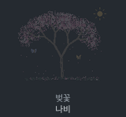](scenes/spring-clear.png)| | [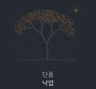](scenes/autumn-clear.png)| [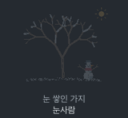](scenes/winter-clear.png)|
| **바람** | | | | |
| **비** | [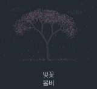](scenes/spring-rain.png)| | [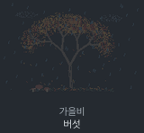](scenes/autumn-rain.png)| [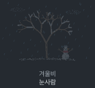](scenes/winter-rain.png)|
| **눈** | | | [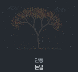](scenes/autumn-snow.png)| |
| **흐림** | [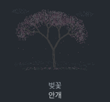](scenes/spring-cloudy.png)| [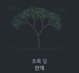](scenes/summer-cloudy.png)| [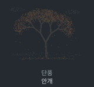](scenes/autumn-cloudy.png)| [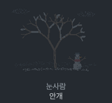](scenes/winter-cloudy.png)|

PNG는 움직이는 풍경의 한 순간입니다. 나비·그네·바람개비·파문·민들레 씨앗·낙엽은 실행 중에 움직입니다. 흐린 날에는 사계절 모두 낮게 흐르는 안개를 볼 수 있습니다.

겨울에 눈이 오면 눈사람의 모자와 어깨에도 눈이 조금씩 쌓입니다.

계절과 날씨를 각각 선택할 수 있어, 여름·눈처럼 드문 조합도 미리보기에 포함했습니다.

## 원하는 장면 바로 실행

| 계절 | 날씨 | 정원의 모습 | 바로 실행 |
| --- | --- | --- | --- |
| 봄 | 맑음 | 벚꽃 · 나비 | `salang --season spring --weather clear` |
| 봄 | 바람 | 벚꽃비 · 민들레 씨앗 | `salang --season spring --weather wind` |
| 봄 | 비 | 벚꽃 · 봄비 | `salang --season spring --weather rain` |
| 봄 | 눈 | 벚꽃 · 눈발 | `salang --season spring --weather snow` |
| 봄 | 흐림 | 벚꽃 · 안개 | `salang --season spring --weather cloudy` |
| 여름 | 맑음 | 초록 잎 · 그네 | `salang --season summer --weather clear` |
| 여름 | 바람 | 초록 잎 · 바람개비 | `salang --season summer --weather wind` |
| 여름 | 비 | 빗물 · 파문 | `salang --season summer --weather rain` |
| 여름 | 눈 | 초록 잎 · 눈발 | `salang --season summer --weather snow` |
| 여름 | 흐림 | 초록 잎 · 안개 | `salang --season summer --weather cloudy` |
| 가을 | 맑음 | 단풍 · 낙엽 | `salang --season autumn --weather clear` |
| 가을 | 바람 | 단풍 · 구르는 낙엽 | `salang --season autumn --weather wind` |
| 가을 | 비 | 가을비 · 버섯 | `salang --season autumn --weather rain` |
| 가을 | 눈 | 단풍 · 눈발 | `salang --season autumn --weather snow` |
| 가을 | 흐림 | 단풍 · 안개 | `salang --season autumn --weather cloudy` |
| 겨울 | 맑음 | 눈 쌓인 가지 · 눈사람 | `salang --season winter --weather clear` |
| 겨울 | 바람 | 눈사람 · 흔들리는 목도리 | `salang --season winter --weather wind` |
| 겨울 | 비 | 겨울비 · 눈사람 | `salang --season winter --weather rain` |
| 겨울 | 눈 | 눈사람 · 소복이 쌓이는 눈 | `salang --season winter --weather snow` |
| 겨울 | 흐림 | 눈사람 · 안개 | `salang --season winter --weather cloudy` |

실행 중 `s`는 계절, `w`는 날씨를 바꿉니다. `l`을 누르면 실제 계절과 날씨로 돌아갑니다.
